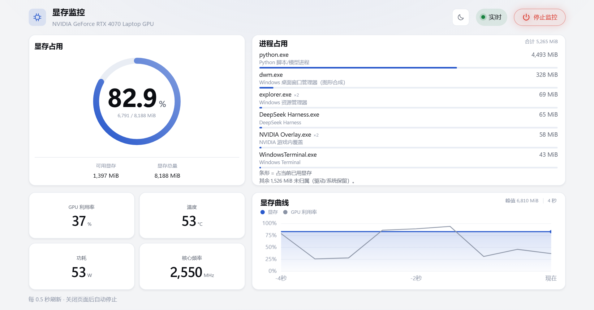

# 显存监控 · VRAM Monitor



一个零依赖的 Windows NVIDIA 显存实时监控工具：Python 标准库后端 + 浏览器一屏仪表盘。启动后自动打开页面；关闭页面约 1 秒后台自动退出。

**当前版本：v1.0.3**

## 功能

- 显存占用环，以及可用 / 总显存
- GPU 利用率、温度、功耗、核心频率四个状态卡
- 最近 60 秒显存与利用率曲线，鼠标悬停查看某一点
- 进程显存前 6 名：同名进程合并数量、来源说明、占用条、未归属差额
- 悬停进程行显示完整路径、PID、多个路径；双击打开所在目录
- 桌面宽度 ≥901px 时按浏览器视口高度一屏装下，不出现纵向滚动
- 深色 / 浅色主题；强调色跟随 Windows 设置
- 右上角红色电源按钮：悬停放大、点击立即停止并退出后台
- 提供免安装 exe 便携包，不需要 Python
- 纯 Python 标准库，无第三方依赖；通过 SSE 实时推送

## 快速开始

### 免安装便携版（推荐）

从 [Releases](https://github.com/Neus117/VRAM-Monitor/releases/latest) 下载 `VRAM-Monitor-v1.0.3-portable.zip`，解压后双击：

```text
VRAM-Monitor.exe
```

不需要安装 Python。这是 PyInstaller 单文件 exe，首次启动会先解压到临时目录，可能比源码版慢一两秒。

### 源码版

从 [Releases](https://github.com/Neus117/VRAM-Monitor/releases/latest) 下载 `VRAM-Monitor-v1.0.3.zip`，解压后双击：

```text
启动显存监控.bat
```

源码版需要本机 Python 3.9+。也可以直接 clone 运行：

```bat
git clone https://github.com/Neus117/VRAM-Monitor.git
cd VRAM-Monitor
python app.py
```

浏览器会自动打开 `http://127.0.0.1:8765/`。端口被占用时会自动换一个，日志里能看到实际地址；默认端口上已经跑着本工具时会直接打开已有页面，不会重复启动。

## 停止

- 点右上角红色电源按钮「停止监控」：立即停止监控、退出后台，并尝试关闭页面；浏览器禁止脚本关标签页时会退到空白页，不会留下“已停止”提示。
- 或直接关闭页面：约 1 秒后自动退出；刷新页面有 1 秒重连宽限，不会误退。
- 命令行启动时也可以按 `Ctrl+C`。

## 快捷方式与开始菜单

便携版：直接右键 `VRAM-Monitor.exe` →「发送到」→「桌面快捷方式」即可，exe 自带图标，不需要改图标。

源码版：`.bat` 本身不能保存自定义图标，图标要设置在快捷方式上。解压后按下面创建。

### 创建桌面快捷方式

1. 打开解压后的 `VRAM-Monitor` 文件夹。
2. 右键 `启动显存监控.bat` →（Windows 11 先点「显示更多选项」）→「发送到」→「桌面快捷方式」。
3. 如果右键菜单里没有「发送到」：在文件夹空白处右键 →「新建」→「快捷方式」，目标填写带引号的完整路径：

```text
"<解压目录>\VRAM-Monitor\启动显存监控.bat"
```

点「下一步」，名称填 `显存监控`，然后点「完成」。
4. 桌面找到 `显存监控 - 快捷方式`，重命名为 `显存监控`。
5. 右键快捷方式 →「属性」→「更改图标」→「浏览」，选择项目目录里的 `icon.ico` →「确定」→「应用」。
6. 双击桌面快捷方式测试。快捷方式的目标是 `.bat`；工作目录不用填也可以，因为 `.bat` 自己会执行 `cd /d "%~dp0"`。

### 固定到开始屏幕

Windows 11 的桌面快捷方式右键菜单不提供「固定到开始屏幕」。如果要把本工具放进开始屏幕：

1. 把刚创建好的桌面快捷方式复制到当前用户的开始菜单程序目录：

```text
%APPDATA%\Microsoft\Windows\Start Menu\Programs\显存监控.lnk
```

实际路径通常是：

```text
C:\Users\<用户名>\AppData\Roaming\Microsoft\Windows\Start Menu\Programs\显存监控.lnk
```

2. 打开「开始」→「所有应用」，找到「显存监控」（或直接搜索），右键选择「固定到“开始”屏幕」。

复制后快捷方式的目标、工作目录和图标与桌面版一致；桌面上的快捷方式可以保留，不必覆盖。

## 依赖

运行 exe 便携版：

- Windows 10 / 11
- NVIDIA 显卡与驱动，`nvidia-smi` 可用
- 不需要 Python

从源码或源码 zip 运行：

- Windows 10 / 11
- NVIDIA 显卡与驱动，`nvidia-smi` 可用
- Python 3.9+，且 `pythonw` 在 `PATH` 中

exe 便携版已经打包 Python 运行时；源码版和双击 `.bat` 仍需要本机 Python。

## 命令行参数

| 参数 | 默认值 | 说明 |
|---|---|---|
| `--port` | `8765` | 监听端口，被占用时自动改用随机端口 |
| `--interval` | `500` | 采样间隔（毫秒） |
| `--no-browser` | 关闭 | 启动后不自动打开浏览器 |
| `--keep-alive` | 关闭 | 没有页面连接时也不自动退出 |
| `--nvidia-smi` | `nvidia-smi` | 指定 nvidia-smi 路径，默认从 PATH 查找 |

## 已知限制

- 进程显存使用 Windows `GPU Process Memory \\ Local Usage`，与任务管理器「专用 GPU 内存」（提交量）不是同一口径，数字可能不同；卡片底部会显示未归属差额。
- 进程来源说明按可执行名推断；未收录的程序显示「来源未识别」，不会编造。
- 多 GPU 环境只做了单卡验证，尚未按 NVIDIA LUID 过滤进程；多显卡 / 核显笔记本可能混入其他 GPU 的进程。
- 普通 Edge 标签页可能被浏览器策略禁止脚本关闭；此时停止后会退到空白页，后台已经退出。
- 受保护进程可能读不到完整路径，悬停时显示「路径不可用」，此时不能双击打开。
- 双击打开的资源管理器可能被 Windows 前台焦点规则压在浏览器后面；用 `Alt+Tab` 或任务栏切过去即可。
- exe 未签名，Windows SmartScreen 可能提示「未知发布者」；选择「更多信息」→「仍要运行」。
- 仅支持 Windows；依赖 NVIDIA 驱动提供的 `nvidia-smi`。

## 实现

- `app.py`：本地 `ThreadingHTTPServer`、SSE 推送、`nvidia-smi` 采样、Windows PDH 进程显存采样。
- `web/index.html`：内联 CSS/JS，无外部资源；桌面端按 `100vh` 压成一屏，窄屏自动上下堆叠。
- GPU 采集保持一个 `nvidia-smi -lms 500` 常驻进程逐行读取，不为每个采样点重复启动。
- 进程采集每 2 秒读一次 Windows `GPU Process Memory` 性能计数器，按进程名合并同名进程。
- 进程行悬停时显示 `QueryFullProcessImageNameW` 读到的完整路径；双击只把 PID 发给本地 `/api/reveal`，由后端重新取路径后打开资源管理器。
- 服务只绑定 `127.0.0.1`；最后一个页面断开后约 1 秒退出。

## 目录

```text
VRAM-Monitor/
  app.py                 本地 HTTP 服务、SSE、GPU + 进程显存采样
  web/index.html         页面（内联 CSS/JS，无外部资源）
  启动显存监控.bat        无控制台启动
  build-portable.ps1     构建 exe 便携包
  version_info.txt       exe 版本资源
  PORTABLE.txt           便携版说明
  icon.ico               快捷方式图标
  icon-preview.png       图标各尺寸预览
  preview-light.png      界面预览
  README.md
  logs/app.log           运行日志（自动轮转，单文件约 1 MB）
```

## 故障排查

若页面提示「GPU 数据不可用」，先在终端执行 `nvidia-smi` 确认驱动正常；详细原因见 `logs/app.log`。如果双击 `.bat` 没有反应，确认 `pythonw` 在 `PATH` 中，或改用 `python app.py` 查看报错。
